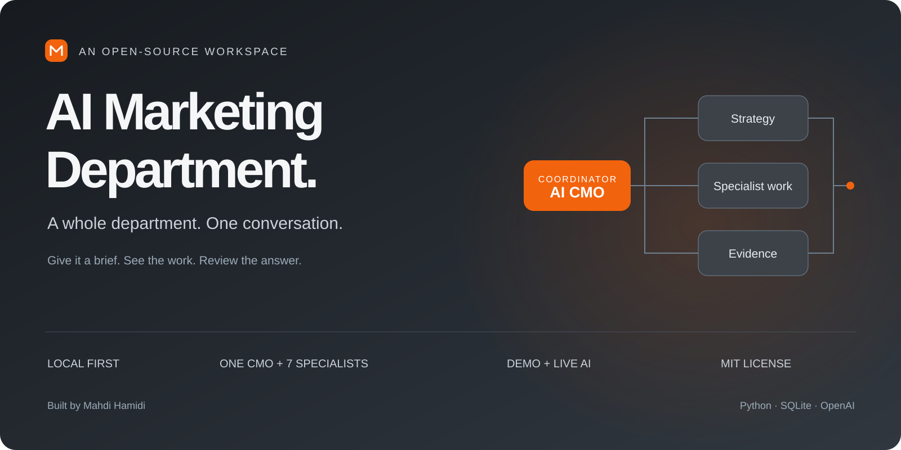
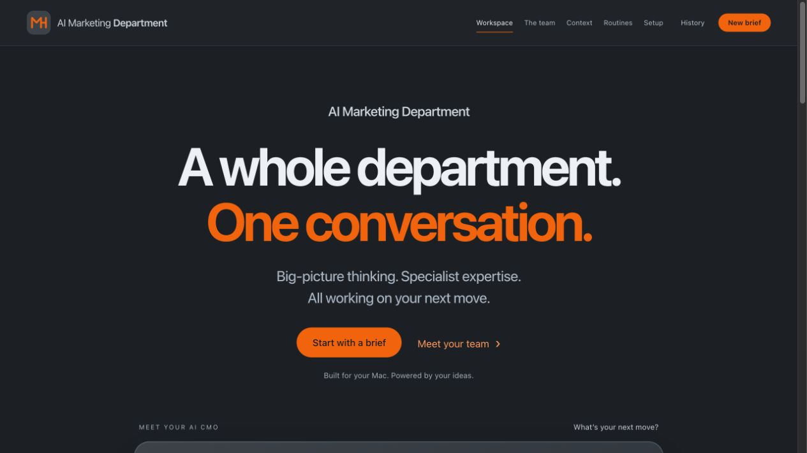
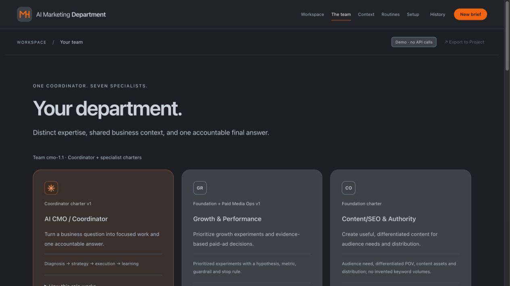
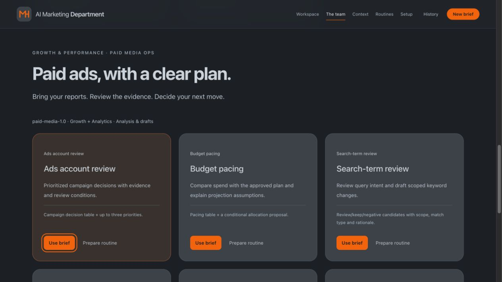
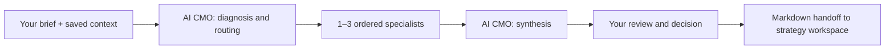

<p align="center"></p>

<p align="center"><strong>A local-first AI marketing workspace. One coordinator. Seven specialist perspectives.</strong></p>
<p align="center">Python standard library · Vanilla JavaScript · SQLite · Bring your own OpenAI API key</p>
<p align="center"><a href="#quick-start">Quick start</a> · <a href="docs/USER-GUIDE.md">User guide</a> · <a href="ARCHITECTURE.md">Architecture</a> · <a href="docs/DEPLOYMENT.md">Deploy</a> · <a href="LICENSE">MIT License</a></p>

Give your AI CMO a brief. It identifies the work, selects 1–3 specialists, tracks their contributions, and returns a synthesized answer. Keep strategy and approved knowledge in a ChatGPT Project; use this app as the execution workspace.

**This is an interactive MVP for analysis and drafts.** It does not connect to ad accounts, send outreach, publish content, browse sources, or spend advertising budgets. Demo works without an API key. Live AI uses your OpenAI API account.



## Why this exists

Marketing work crosses disciplines. A launch may need positioning before copy; a performance review may need a data check before a budget recommendation. This app makes that handoff visible, while keeping the workflow small enough to inspect and run locally.

It uses one configurable model with different role instructions. The specialists are software roles, not independently trained models or real employees.

## The department

| Role | Responsibility |
| --- | --- |
| AI CMO / Coordinator | Diagnose, delegate, review, synthesize |
| AgentOps & AI Systems | Workflow quality, evaluation design, failure analysis |
| Growth & Performance | Growth experiments and paid-media decision support |
| Content/SEO & Authority | Content, search intent, editorial plans, distribution |
| Outbound & Lifecycle | Outreach drafts, onboarding, nurture, retention |
| Analytics & CRO | Data quality, funnel diagnosis, measurement, experiments |
| Product Marketing & GTM | Segments, alternatives, positioning, messaging, launches |
| Brand & Demand Creation | Brand promise, distinctive assets, category demand |

## What you can do today

- Chat with a coordinator and inspect ordered specialist tasks and their status.
- Save a shared business brief; each new run snapshots the relevant context and role instructions.
- Review history, token usage, partial results and useful/needs-work feedback.
- Export conversations as Markdown for your strategy workspace.
- Save daily, weekly or monthly routine briefs and **start them manually**.
- Use six Paid Media Ops briefs: account review, budget pacing, search terms, creative health, Performance Max and decision reporting.
- Run on your Mac, or Linux, without installing runtime packages.



## Quick start

**Requirements:** Python 3.9+ on macOS or Linux, and a modern browser. Windows native execution is not supported because the database lock uses `fcntl`; use a Linux environment instead.

Download and extract the repository ZIP, open a terminal in the extracted folder, then run:

```sh
python3 server.py --open-browser
```

Open **http://127.0.0.1:8765/** if it does not open automatically. On macOS, run `chmod +x *.command` once if needed, then double-click **Start.command**. Keep the terminal window open. Stop with Control-C.

1. Leave the composer in **Demo** mode.
2. Send a brief, such as “Help plan a product launch. Start with the business context you need.”
3. Watch routing, specialist tasks and the final template. Demo makes **zero API calls** and does not analyze your data.
4. Open **Context** and use the guided business brief before working on a real project.

No `pip install`, Node.js, Docker, database service or paid hosting is required for local use. Node.js is only needed to run the JavaScript tests.

### Enable Live AI

```sh
cp .env.example .env
```

Edit `.env` locally:

```dotenv
OPENAI_API_KEY=your_own_key
OPENAI_MODEL=gpt-4.1-mini
PORT=8765
```

Restart the server, choose **Live AI**, and send your brief. The model shown is the repository default, not a guarantee of account availability. The selected model must support the Responses API and the structured-output contract used in `server.py`.

**Billing:** a completed Live brief normally uses 3–5 API calls: routing, 1–3 specialists, synthesis. Input and output tokens are billed to your OpenAI API account. A ChatGPT subscription does not pay those API charges. Failed or cancelled runs may still incur charges for requests already sent. The five-call cap is not a monetary spending limit. Consult [current OpenAI API pricing](https://openai.com/api/pricing/) and configure account/project controls separately.

### Optional configuration

| Variable | Default | Purpose |
| --- | --- | --- |
| `OPENAI_API_KEY` | empty | Required for Live only; server-side |
| `OPENAI_MODEL` | `gpt-4.1-mini` | Model used by every role |
| `PORT` | `8765` | Local loopback server port |
| `AMD_DATA_DIR` | `./data` | Private SQLite storage directory |
| `APP_ORIGIN` | local URL | Public origin only when using an authenticated deployment |

## Paid Media Ops

Open **The team** and choose a workflow. **Use brief** fills an editable request. **Prepare routine** fills a routine draft. Neither button sends a model request or saves/starts a routine automatically.

Paste relevant report rows as text or CSV. A file path or URL is not an uploaded report. Recommendations stay proposals: there are no account connectors or campaign-change tools.



## Knowledge, training and ChatGPT Projects

Start with [the user guide](docs/USER-GUIDE.md), [knowledge templates](knowledge-kit/README.md), and [ChatGPT Project instructions](CHATGPT-PROJECT.md).

“Training” in this MVP means improving reference context, role instructions and evaluation examples. Saving context or feedback does **not** fine-tune a model. The app does not automatically search documents, embed files or synchronize with ChatGPT. Approved context moves in by copy/paste; completed work moves out through Markdown exports.

## Privacy and hosting

History and settings are stored in your local SQLite database. In Live mode, relevant briefs, shared context, recent same-mode conversation history and specialist outputs are sent to OpenAI. Never include information you do not want sent to that service.

The local server binds to `127.0.0.1`. Its session cookie protects against cross-site requests; it is **not authentication**. Do not expose `server.py` directly to the internet. The optional owner-protected wrapper and Cloudflare Tunnel setup are documented in [Deployment](docs/DEPLOYMENT.md). Online access depends on the host remaining awake and connected. This is a single-owner MVP, not a multi-tenant service.

Private configuration, databases and downloaded tunnel binaries are excluded from this repository. An MIT license for the source does not include API credits, hosting, or rights to third-party services.

## Architecture



The server validates a structured routing plan, executes specialists sequentially, and saves progress in SQLite. There are at most two active runs overall and one per conversation. Runs are not silently replayed after restart. See [architecture and failure semantics](ARCHITECTURE.md).

## Development and validation

```sh
python3 -m unittest discover -s tests -p 'test_*.py'
node --test tests/test_format.cjs tests/test_ui.cjs
```

Software tests use temporary databases and mocked providers. They do not spend API credits or establish real-model marketing quality. Evaluation scenarios in `evals/` are review cases, not claimed benchmark results. See [VALIDATION.md](VALIDATION.md).

## Roadmap

- [ ] Real-project evaluations and documented failure cases
- [ ] Source provenance, freshness and curated retrieval
- [ ] Read-only marketing data connectors
- [ ] Durable scheduling and explicit usage budgets
- [ ] Reviewable approvals before any external action tools
- [ ] Stronger authentication and deployment hardening before multi-user use

## Contributing

Small, evidence-backed improvements are welcome. Read [CONTRIBUTING.md](CONTRIBUTING.md) and [SECURITY.md](SECURITY.md). Avoid adding autonomous action tools without a clear threat model, review flow and tests.

Created by **Mahdi Hamidi**. Released under the [MIT License](LICENSE).
